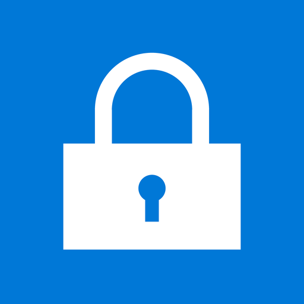

# SpartanLock

A **Windows 10 Mobile style lock screen for Android**, built to pair with [Spartan Launcher](https://github.com/kennethmccullers29-dot/SpartanLauncher) and [SpartanBar](https://github.com/kennethmccullers29-dot/SpartanBar). Fan project, not affiliated with Microsoft.

## Download

Grab **SpartanLock-v1.0.apk** from [Releases](https://github.com/kennethmccullers29-dot/SpartanLock/releases/latest) and install it (allow installs from unknown sources).

## Features

- **W10M lock screen**: big Selawik clock and date, launcher wallpaper, slide-up to unlock, several lock themes.
- **TrueSight**: a face-style unlock smiley ("TrueSight is looking…") with looking / success / fail animations, a greeting name and an optional overlay PIN. It rides on your phone's own biometric unlock; the system keyguard stays the real lock.
- **Glance**: a dim always-on style clock screen.
- **Filled MDL2 icons** for mail, messages, phone, calendar and the camera shortcut.
- **Icon-pack notifications**: notification icons from other apps use the icon pack you picked in Spartan Launcher (when one is set).
- **Media**: sharp album-art background with artist images crossfading in, plus lock-screen media controls.
- Calendar events, call state and notifications on the lock screen.
- Hidden from the app switcher.

Settings live in Spartan Launcher → Settings → Personalization → Lock screen / TrueSight.

## Permissions

| Permission | Why |
|---|---|
| Accessibility service | Draws the lock screen over the system keyguard and hides it on unlock |
| Notification access | Shows notifications and media controls on the lock screen |
| `READ_CALENDAR` | Upcoming events on the lock screen |
| `USE_BIOMETRIC` | TrueSight unlock |
| `WAKE_LOCK`, `TURN_SCREEN_ON` | Waking the screen for Glance and new notifications |

Nothing leaves the device. The settings provider shared with Spartan Launcher is signature-protected.

## Build

Open in Android Studio (compileSdk 37, minSdk 24) or run `./gradlew assembleDebug`. Release signing reads `../keys/keystore.properties`, which is not in this repo.

## Credits

Selawik font by Microsoft (SIL OFL, see `third_party/selawik/LICENSE.txt`).
